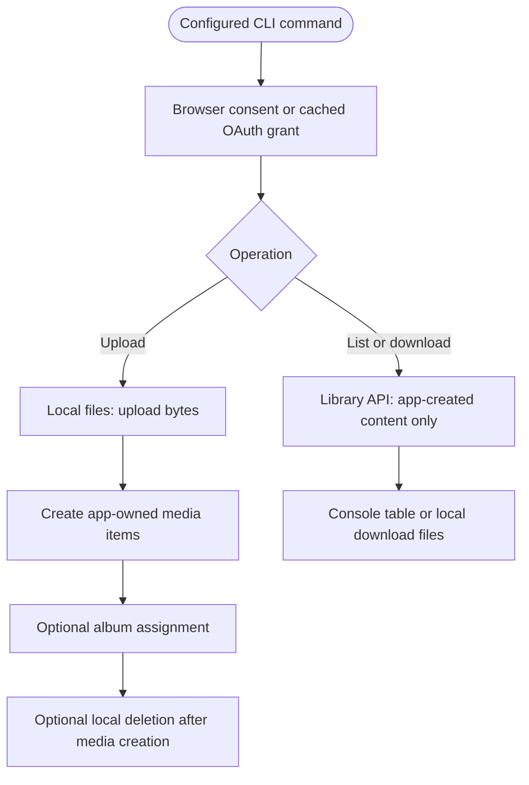

# CasCap.GooglePhotosCli

`googlephotos` is an unofficial Google Photos command-line tool for uploading local media and managing the albums and media created by its OAuth application. It is distributed as a .NET global tool for users who supply their own Google OAuth desktop client.

[cascap.googlephotoscli-badge]: https://img.shields.io/nuget/v/googlephotos?color=blue
[cascap.googlephotoscli-url]: https://nuget.org/packages/googlephotos

[](https://github.com/f2calv/CasCap.GooglePhotosCli/actions/workflows/ci.yml) [![NuGet version][cascap.googlephotoscli-badge]][cascap.googlephotoscli-url]

## Google Photos Access Limits

Google's [Photos API restrictions](https://developers.google.com/photos/support/updates), checked on 20 October 2026, constrain this tool and its underlying [CasCap.Api.GooglePhotos library](https://github.com/f2calv/CasCap.Api.GooglePhotos):

- The Library API can only see **albums and media items created by this tool's own OAuth client**. Content added outside that application is invisible to it.
- Reading an entire library, and therefore whole-library duplicate detection and whole-library backup, is no longer possible.
- Library API sharing and shared-album operations were withdrawn entirely.
- Existing user media requires interactive selection through the Picker API. **This CLI has no Picker command**; configuring a Picker scope does not add one.

`albums list --duplicates` detects duplicate **album titles among app-created albums**, not duplicate photos. There is no whole-library backup, sync, duplicate-media scan or sharing command.

## Quick Start

Install the [.NET SDK](https://dotnet.microsoft.com/download/dotnet/10.0) to manage global tools and the .NET 10 runtime to run this `net10.0` tool, available from [NuGet](https://www.nuget.org/packages/googlephotos):

```powershell
dotnet tool install --global googlephotos
googlephotos --help
```

For an existing installation:

```powershell
dotnet tool update --global googlephotos
```

After [Google Cloud setup](#google-cloud-setup) and [configuration](#configuration), `googlephotos albums list` authenticates and displays only app-created albums. The initial browser consent cannot be replaced by `--yes`.

## Google Cloud setup

1. Create a project in the [Google Cloud console](https://console.cloud.google.com/).
2. Open **APIs & Services > Library** and enable **Google Photos Library API**.
3. Configure the OAuth consent screen and create an **OAuth client ID** of type **Desktop app**.
4. Note the client ID and client secret; they are supplied through configuration below.

Full setup guidance lives in the [library documentation](https://github.com/f2calv/CasCap.Api.GooglePhotos#google-cloud-setup).

## Configuration

The concrete [GooglePhotosOptions](https://github.com/f2calv/CasCap.Api.GooglePhotos/blob/4.0.7/src/CasCap.Api.GooglePhotos/Models/GooglePhotosOptions.cs) configuration is bound at `CasCap:GooglePhotosOptions`. The [host configuration](https://github.com/f2calv/CasCap.GooglePhotosCli/blob/6bd51e8/src/CasCap.GooglePhotosCli/AppHost.cs) loads, in ascending precedence, shipped `appsettings.json`, working-directory `appsettings.json`, the tool's .NET User Secrets, and environment variables. Command-line options do not provide credential overrides.

Do not edit the installed tool store. For the current checkout, supply credentials in your shell:

```powershell
$env:CasCap__GooglePhotosOptions__User = "your.email@example.com"
$env:CasCap__GooglePhotosOptions__ClientId = "000000000000-aaaaaaaaaaaaaaaaaaaaaaaaaaaaaaaa.apps.googleusercontent.com"
$env:CasCap__GooglePhotosOptions__ClientSecret = "your-client-secret"
```

`User`, `ClientId`, `ClientSecret` and a nonempty `Scopes` array are required. The shipped file already selects all three Library API scopes below. Set only the scopes you need, but note that title lookup and upload-to-album operations also read existing app-created albums.

## Configuration Examples

A minimal working-directory `appsettings.json` for read-only listing/downloading (replace the synthetic credentials locally and keep the file out of Git):

```json
{
  "CasCap": {
    "GooglePhotosOptions": {
      "User": "user@example.com",
      "ClientId": "000000000000-aaaaaaaaaaaaaaaaaaaaaaaaaaaaaaaa.apps.googleusercontent.com",
      "ClientSecret": "replace-locally",
      "Scopes": ["ReadOnlyAppCreatedData"]
    }
  }
}
```

For upload and album management, this complete configuration includes the shipped scope set:

```json
{
  "CasCap": {
    "GooglePhotosOptions": {
      "User": "your.email@example.com",
      "ClientId": "000000000000-aaaaaaaaaaaaaaaaaaaaaaaaaaaaaaaa.apps.googleusercontent.com",
      "ClientSecret": "your-client-secret",
      "Scopes": [
        "AppendOnly",
        "ReadOnlyAppCreatedData",
        "EditAppCreatedData"
      ]
    }
  }
}
```

| Scope | Needed for |
| --- | --- |
| `AppendOnly` | Create media items and albums; title-based lookup also needs app-created read access |
| `ReadOnlyAppCreatedData` | `albums list`, `albums download`, `mediaitems list` |
| `EditAppCreatedData` | Adding uploaded media items to albums |

OAuth opens browser consent when a reusable grant is unavailable. The library refreshes stale access tokens; the client ID/secret are still required, not a service-account or API-key substitute. Google can expire or revoke refresh grants; see [OAuth refresh-token limits](https://developers.google.com/identity/protocols/oauth2#expiration), including the seven-day limit for external apps in Testing with these scopes.

The current checkout defaults the Google authentication cache to `%APPDATA%\googlephotos\auth` on Windows (the platform application-data equivalent elsewhere). `FileDataStoreFullPathOverride` can select a different **tool-owned** directory. `googlephotos logout` recursively deletes that entire configured directory, not just one account, and does not revoke Google's server-side authorization. It avoids login but still resolves validated options, so keep valid configuration for logout.

## Usage

Every command has context-sensitive help:

```powershell
googlephotos --help
googlephotos albums --help
```

### Albums

```powershell
# list the albums this tool created
googlephotos albums list

# show only albums which share a title with another album
googlephotos albums list --duplicates

# create an empty album
googlephotos albums add -t "my album title"

# download an album's media items
googlephotos albums download -t "my album title" -o ./download

# download resized, cropped copies retaining EXIF except location metadata
googlephotos albums download -t "my album title" -o .\download --maxwidth 100 --maxheight 100 --crop --exif --overwrite
```

### Media items

```powershell
# list the media items this tool created
googlephotos mediaitems list

# upload a folder tree
googlephotos mediaitems upload -s ./photos

# upload only JPEGs, into a named album, without prompting
googlephotos mediaitems upload -s .\photos --pattern "*.jpg" -t "Example album" -y

# assign each file to albums named for its ancestor folders below the source root
googlephotos mediaitems upload -s ./photos --hierarchy
```

### Sign out

```powershell
googlephotos logout
```

### Command Contract

| Command and defining source | Required options | Additional options and behavior |
| --- | --- | --- |
| [`albums list`](https://github.com/f2calv/CasCap.GooglePhotosCli/blob/main/src/CasCap.GooglePhotosCli/Commands/Albums.cs) | None | `--duplicates` filters repeated titles, case-insensitively |
| [`albums add`](https://github.com/f2calv/CasCap.GooglePhotosCli/blob/main/src/CasCap.GooglePhotosCli/Commands/Albums.cs) | `-t` / `--title` | Get or create by title |
| [`albums download`](https://github.com/f2calv/CasCap.GooglePhotosCli/blob/main/src/CasCap.GooglePhotosCli/Commands/Albums.cs) | `-t` / `--title` | `-o` / `--output` defaults to the current directory; `-y` / `--yes` creates it without prompting; `-w` / `--maxwidth`, `-h` / `--maxheight`, `--crop`, `--exif`, `--overwrite` |
| [`mediaitems list`](https://github.com/f2calv/CasCap.GooglePhotosCli/blob/main/src/CasCap.GooglePhotosCli/Commands/MediaItems.cs) | None | Lists app-created media as a console table |
| [`mediaitems upload`](https://github.com/f2calv/CasCap.GooglePhotosCli/blob/main/src/CasCap.GooglePhotosCli/Commands/Upload.cs) | `-s` / `--source` | `--pattern` defaults to `*.*`; `-t` / `--title`, `-h` / `--hierarchy`, `-y` / `--yes`, `-d` / `--delete` |
| [`logout`](https://github.com/f2calv/CasCap.GooglePhotosCli/blob/main/src/CasCap.GooglePhotosCli/Commands/Logout.cs) | None | `-y` / `--yes` skips the local deletion prompt, not credential validation |

There is no stable machine-readable JSON output mode. Commands emit human-readable tables, progress and error messages.

### Transfer Behavior

- Upload recursively selects supported files, asks for confirmation unless `--yes`, uploads bytes, creates media items, then assigns albums. `--title` takes precedence over `--hierarchy`; files at the hierarchy root get no derived album.
- Duplicate app-created album titles block title-based upload assignment. There is no persistent upload journal or whole-library deduplication.
- **`--delete` is destructive:** it deletes local files whose media-item creation succeeded, even if album assignment later reported failure. Album-assignment failure does not independently make the process fail.
- Download skips existing filenames case-insensitively, without comparing contents; `--overwrite` re-downloads them. A missing/expired album URL can fail the command, but an individual download returning no bytes is skipped and the overall command may still return success. This is not a verified archival backup.
- Parsing, option validation and authentication failures return `1`; ordinary successful or declined/no-work operations generally return `0`. Do not treat that as a guarantee that every transfer or album assignment succeeded.

## Data Flow



The diagram describes Library API operations, not a Picker or whole-library path. All essential behavior is also explained in text for package renderers without Mermaid support.

## Development

Use the .NET 10 SDK. The [source delivery-unit README](https://github.com/f2calv/CasCap.GooglePhotosCli/blob/main/src/CasCap.GooglePhotosCli/README.md) covers host wiring; the [test README](https://github.com/f2calv/CasCap.GooglePhotosCli/blob/main/src/CasCap.GooglePhotosCli.Tests/README.md) covers the offline suite.

```powershell
dotnet build CasCap.GooglePhotosCli.Release.slnx -c Release
```

The Debug configuration resolves `CasCap.Api.GooglePhotos` through a sibling local project reference. Release uses the published NuGet dependency; no sibling checkout is required.

## Feedback and issues

Please raise anything on the [GitHub issues page](https://github.com/f2calv/CasCap.GooglePhotosCli/issues).

## License

This project is released under the [MIT License](https://github.com/f2calv/CasCap.GooglePhotosCli/blob/main/LICENSE).
