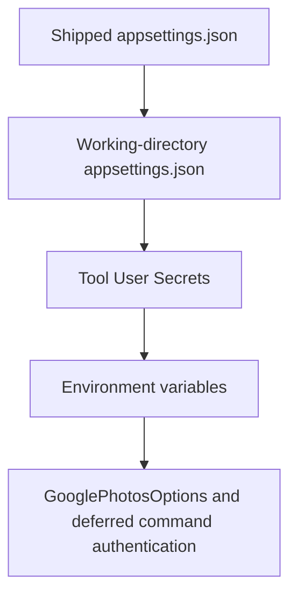

# CasCap.GooglePhotosCli

This `net10.0` executable is the source delivery unit for the `googlephotos` .NET global tool. It provides Library API commands for uploading local media and listing or downloading content created by the configured OAuth application, not a general Google Photos backup client.

## Usage

Use the [consumer README](../../README.md) for installation, Google Cloud setup, complete credential examples and the command/option contract. The package ID and executable name are both `googlephotos`; the root README is embedded in that package.

For source development, use a .NET 10 SDK and build from the repository root:

```powershell
dotnet build CasCap.GooglePhotosCli.Release.slnx -c Release
```

Release resolves the published `CasCap.Api.GooglePhotos` package. Debug instead requires its sibling source checkout because the [project](CasCap.GooglePhotosCli.csproj) uses a configuration-conditional project reference.

## Command Surface

These are concrete internal command types, not a public library interface:

| Definition | Responsibility |
| --- | --- |
| [Program](Program.cs) | Root `googlephotos` command, `--help`, version and subcommand declarations |
| [Albums](Commands/Albums.cs) | `albums list`, `albums add`, `albums download`; app-created albums only |
| [MediaItems](Commands/MediaItems.cs) | `mediaitems list` and registration of upload; app-created media only |
| [Upload](Commands/Upload.cs) | `mediaitems upload`, recursive selection, creation, album assignment and optional local deletion |
| [Logout](Commands/Logout.cs) | Delete the configured tool-owned OAuth-cache directory |

There is no Picker command, whole-library sync or duplicate-media scan. `albums list --duplicates` only compares app-created album titles.

## Configuration Hierarchy

The [AppHost](AppHost.cs) loads the following providers in order; later values override earlier ones:



Configuration binds to the concrete [GooglePhotosOptions](https://github.com/f2calv/CasCap.Api.GooglePhotos/blob/4.0.6/src/CasCap.Api.GooglePhotos/Models/_GooglePhotosOptions.cs) type at `CasCap:GooglePhotosOptions` (linked to the published dependency's definition). Required user/client credentials and scopes are documented in the [root configuration examples](../../README.md#configuration-examples). The [shipped defaults](appsettings.json) request the three supported Library API scopes.

Host startup validation is removed so help can be parsed without credentials. Options validation still runs when an API command first resolves the lazy client, and logout still reads validated options. The default OAuth cache is the platform application-data directory plus `googlephotos/auth`; logout recursively deletes the configured cache directory.

## Behavior and Validation

The [shared command base](Commands/Base/CommandBase.cs) logs in before API operations. Transfers have no CLI-owned persistent journal. Upload deletion is conditional on media-item creation, not album assignment; see the root [transfer warnings](../../README.md#transfer-behavior).

The [offline tests](../CasCap.GooglePhotosCli.Tests/README.md) cover command parsing and album-table rendering, not live authentication or successful transfers.
